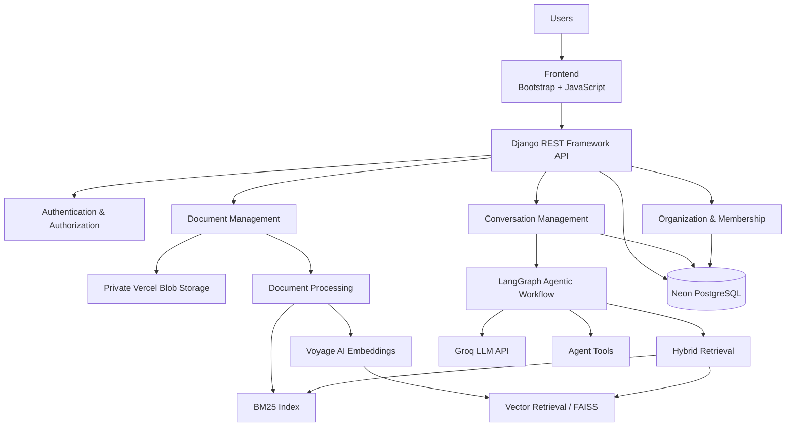
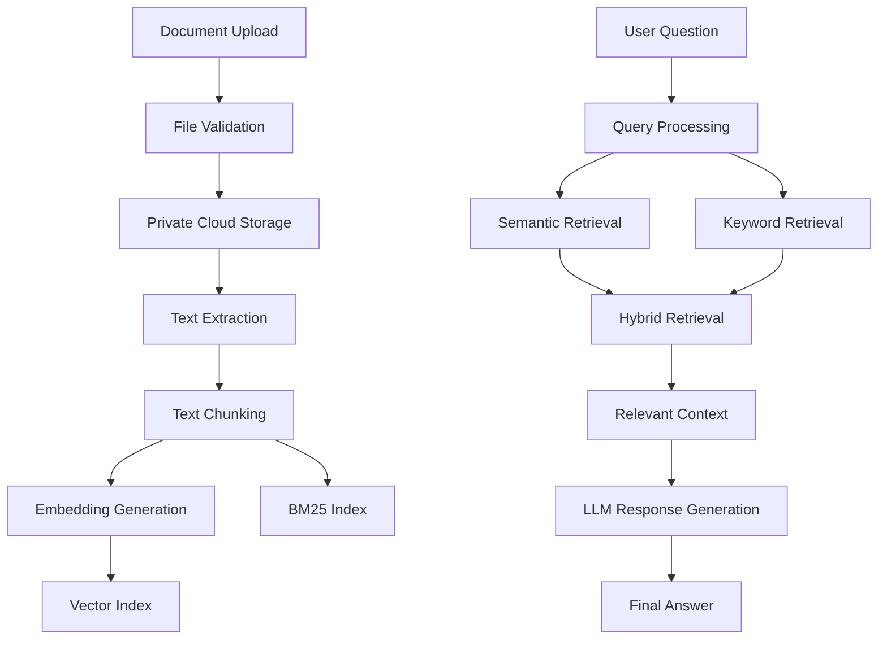

# NexusAI — Enterprise AI Knowledge & Workflow Copilot

<p align="center">
  <strong>Turn organizational knowledge into actionable intelligence.</strong>
</p>

<p align="center">
  An AI-powered enterprise knowledge platform that enables organizations to securely access information, retrieve insights from internal documents, and execute knowledge-driven workflows through an intelligent agentic system.
</p>

<p align="center">
  
  
  
  
  
  
</p>

<p align="center">
  <a href="[YOUR_LIVE_DEMO_URL](https://nexus-ai-ashy-iota.vercel.app/)">Live Demo</a> •
  <a href="https://github.com/Suhrid2425/NexusAI">Source Code</a> •
  <a href="#architecture">Architecture</a> •
  <a href="#features">Features</a>
</p>

---

## 1. The Problem

Organizations generate enormous amounts of information across documents, reports, policies, internal knowledge bases, and operational records.

However, accessing the right information at the right time remains difficult.

Employees often have to:

- Search through multiple documents to find specific information.
- Manually extract insights from lengthy reports.
- Repeat research and analysis that has already been performed.
- Switch between different tools to complete knowledge-based tasks.
- Depend on colleagues to locate institutional knowledge.

Traditional document management systems store information. Basic AI chatbots answer questions.

**NexusAI aims to bridge the gap between organizational knowledge and intelligent execution.**

## 2. The Solution

NexusAI is an Enterprise AI Knowledge & Workflow Copilot designed to help organizations interact with their internal knowledge through natural language.

It combines Retrieval-Augmented Generation (RAG), hybrid information retrieval, and agentic AI workflows in a unified platform.

Users can upload organizational documents, ask contextual questions, retrieve relevant information, and use AI-powered workflows to solve knowledge-intensive tasks.

The goal is to transform scattered organizational information into an accessible, searchable, and actionable knowledge system.

## 3. Core Features

### Intelligent Document Management

- Upload and manage organizational documents.
- Extract text from supported document formats.
- Store documents using private cloud object storage.
- Retrieve documents through authenticated application endpoints.
- Manage documents within organization-specific workspaces.

### Retrieval-Augmented Generation (RAG)

- Document-aware question answering.
- Semantic retrieval using vector embeddings.
- Keyword-based retrieval using BM25.
- Hybrid retrieval combining semantic and lexical search.
- Context-aware response generation.
- Reduced reliance on unsupported model assumptions by grounding answers in retrieved context.

### Agentic AI Workflows

NexusAI uses LangGraph to orchestrate multi-step AI workflows.

The agentic architecture is designed to:

- Interpret user requests.
- Determine appropriate workflow steps.
- Select relevant tools.
- Retrieve organizational information.
- Execute supported operations.
- Combine intermediate results into a final response.

### Conversational Intelligence

- Organization-specific conversations.
- Persistent conversation history.
- Context-aware follow-up questions.
- Conversation creation and management.
- AI-powered responses grounded in relevant context.

### Multi-Tenant Organization Management

- Organization-based workspaces.
- Membership-based access.
- Organization-scoped documents and conversations.
- Authenticated API access.
- Separation of organizational data through application-level access controls.

### Secure Application Architecture

- JWT-based authentication.
- Permission-controlled API endpoints.
- Private document storage.
- Authenticated document download.
- File validation and upload-size restrictions.
- Organization membership verification.

## 4. Architecture

NexusAI follows a modular architecture separating the application layer, AI orchestration layer, retrieval pipeline, and data infrastructure.



### Architectural Components

| Layer | Technology | Responsibility |
|---|---|---|
| Frontend | HTML, Bootstrap, JavaScript | User interface and interactions |
| Backend | Django | Application logic and business rules |
| API | Django REST Framework | REST API and request handling |
| Authentication | JWT | Authenticated API access |
| Database | PostgreSQL (Neon) | Persistent application data |
| AI orchestration | LangGraph | Multi-step agentic workflows |
| LLM inference | Groq | Language model inference |
| Embeddings | Voyage AI | Semantic representation of documents |
| Vector retrieval | FAISS | Similarity-based retrieval |
| Keyword retrieval | BM25 | Lexical information retrieval |
| Object storage | Vercel Blob | Private document storage |
| Deployment | Vercel | Application deployment |

## 5. How the RAG Pipeline Works

A simplified view of the document question-answering pipeline:



The retrieval pipeline combines semantic similarity with keyword matching to improve the discovery of relevant information.

This is particularly useful when users ask questions using different wording from the original documents.

## 6. Agentic AI Workflow

Beyond conventional question answering, NexusAI uses an agentic workflow architecture.

LangGraph provides a structured way to coordinate multiple processing steps and tools.

A typical workflow follows this pattern:

1. Receive the user's request.
2. Analyze the request and conversation context.
3. Determine whether document retrieval or another supported tool is required.
4. Execute the selected workflow steps.
5. Process intermediate results.
6. Generate the final response.

This architecture provides a foundation for extending the platform with additional enterprise tools and workflows.

## 7. Technology Stack

**Languages**
- Python
- JavaScript
- HTML
- CSS

**Backend & APIs**
- Django
- Django REST Framework
- JWT Authentication

**Artificial Intelligence**
- LangChain
- LangGraph
- Retrieval-Augmented Generation
- Large Language Models
- Voyage AI Embeddings
- Groq API

**Information Retrieval**
- FAISS
- BM25
- Hybrid Search
- Semantic Search

**Database & Infrastructure**
- PostgreSQL
- Neon
- Vercel Blob
- Vercel

**Frontend**
- Bootstrap
- Vanilla JavaScript
- Django Templates

## 8. Security Considerations

Enterprise knowledge systems must protect sensitive organizational information.

NexusAI incorporates application-level security measures including:

- Authentication for protected API operations.
- Organization membership checks.
- Organization-scoped resource access.
- Private object storage for uploaded documents.
- Authenticated document retrieval.
- Server-side file validation.
- Restricted document upload sizes.

Security is treated as an architectural requirement rather than an optional feature.

*Note: These application-level controls should not be interpreted as independent security certification, compliance certification, or a completed third-party penetration test.*

## 9. Potential Use Cases

| Industry / Team | Potential Application |
|---|---|
| Startups | Centralized company knowledge and internal AI assistant |
| Software companies | Technical documentation search and engineering knowledge access |
| IT services | Internal documentation and project knowledge retrieval |
| Consulting firms | Research, report analysis, and knowledge discovery |
| HR departments | Employee policies and organizational documentation |
| Finance teams | Financial report and internal document analysis |
| Operations | Standard operating procedure (SOP) discovery |
| Education | Institutional knowledge and document-based assistance |

These are potential applications of the platform, not claims of existing customer deployments.

## 10. Local Development Setup

### Prerequisites

- Python 3.12
- PostgreSQL
- Git
- API credentials for the configured AI and storage providers

### Clone the Repository

```bash
git clone YOUR_GITHUB_REPOSITORY_URL
cd NexusAI
```

### Create a Virtual Environment

Windows PowerShell:

```powershell
py -3.12 -m venv .venv
.venv\Scripts\Activate.ps1
```

### Install Dependencies

```powershell
pip install -r backend/requirements.txt
```

### Configure Environment Variables

Create a `.env` file in the backend directory using the variable names expected by your application.

```env
SECRET_KEY=your_django_secret
DEBUG=True

DATABASE_URL=your_database_connection_string

GROQ_API_KEY=your_groq_api_key
VOYAGE_API_KEY=your_voyage_api_key

NEXUS_READ_WRITE_TOKEN=your_vercel_blob_token
```

Never commit real credentials or production secrets to GitHub.

### Run Database Migrations

```powershell
cd backend
python manage.py migrate
```

### Start the Development Server

```powershell
python manage.py runserver
```

Open:

```text
http://127.0.0.1:8000/
```

## 11. Testing

The project includes Django application and API testing workflows.

Run the Django system check:

```powershell
python manage.py check
```

Run the relevant test suite using the project's configured test settings:

```powershell
python manage.py test core.tests --settings=config.test_settings
```

Additional production validation should cover authentication, tenant isolation, document lifecycle operations, retrieval quality, agentic workflow execution, and failure handling.

## 12. Engineering Challenges

The project involves several practical engineering challenges:

- Designing an organization-aware backend architecture.
- Integrating AI workflows into a conventional web application.
- Combining semantic and keyword-based retrieval.
- Handling private document storage in a serverless deployment environment.
- Connecting asynchronous third-party SDK operations with Django application code.
- Managing external AI provider credentials across environments.
- Designing API-level access controls for organization-specific resources.
- Handling failures across multiple external services.

These challenges make NexusAI an exercise in full-stack engineering, AI systems integration, and production-oriented application design.

## 13. Future Scope

Potential areas for further development include:

- Enterprise integrations with cloud drives and collaboration platforms.
- Advanced workflow automation.
- More sophisticated document indexing and retrieval strategies.
- Observability, tracing, and AI evaluation.
- Administrative analytics and usage monitoring.
- Enterprise SSO and advanced identity management.
- Scalable background document-processing infrastructure.

## 14. Project Information

**Project:** NexusAI  
**Category:** Enterprise AI / Agentic AI / RAG  
**Architecture:** Full-stack, API-driven, multi-tenant application  
**Development:** Independent engineering project  
**Status:** Feature-complete development; ongoing production validation

**Live Application:** YOUR_LIVE_DEMO_URL  
**Repository:** YOUR_GITHUB_REPOSITORY_URL

---

## Author

**YOUR NAME**

Artificial Intelligence Engineering Student | AI Systems & Backend Development

Interested in building practical AI products, intelligent automation systems, and scalable software infrastructure.

[LinkedIn]([YOUR_LINKEDIN_URL](https://www.linkedin.com/in/suhrid-mandal-46a269249/)) • [GitHub]([YOUR_GITHUB_PROFILE_URL](https://github.com/Suhrid2425)) • [Email](smsuhrid@gmail.com)

---

<p align="center">
  <strong>NexusAI — From organizational knowledge to intelligent action.</strong>
</p>
